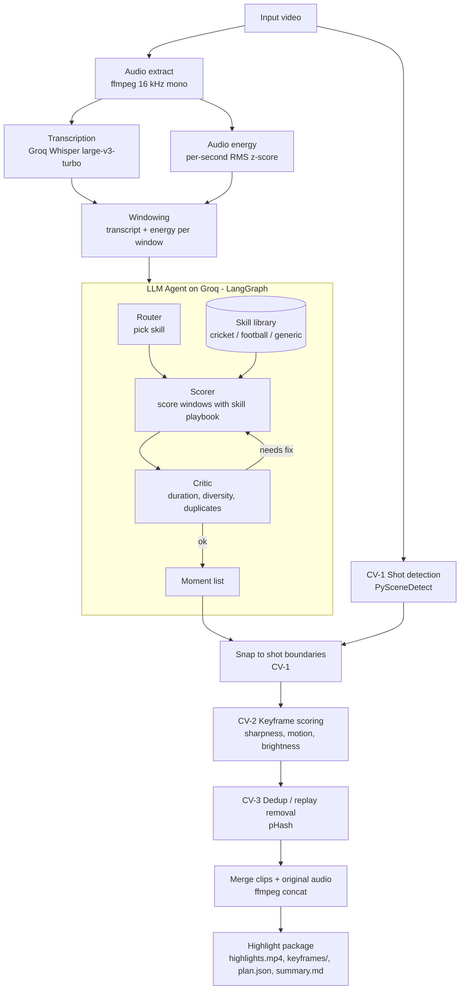

# Agentic Highlight Maker — Project Spec

**One line:** Give it a ~30-minute video. It listens to the commentary, finds the high moments, snaps each one to clean shot boundaries and the best keyframes (classical computer vision), and merges them into a highlight video with the original audio in sync. An LLM agent with swappable *sport skills* (cricket, football, generic) decides what counts as a highlight.

---

## 1. Goals and non-goals

**Goals**
- Input: one video file (about 30 min). Output: `highlights.mp4` (target 1–3 min) plus a highlight package (keyframes, plan, summary).
- Highlight selection driven by the **transcript** (excitement, sentiment, keywords) plus audio loudness.
- A clearly visible **computer vision** contribution: shot-boundary detection, keyframe scoring, and duplicate/replay removal.
- Agentic behavior: skill routing, tool use, and a critic loop that revises the plan.
- All LLM and speech calls run on **Groq**.

**Non-goals**
- No annotations, overlays, bounding boxes or captions drawn on the video.
- No CLIP and no model training.
- No real-time or live-stream processing.

---

## 2. Where the CV is (what to say in the report)

| # | CV component | Method | Why it matters |
|---|---|---|---|
| CV-1 | Shot boundary detection | PySceneDetect `ContentDetector` (HSV frame difference) | Clips start and end on clean cuts, not mid-shot |
| CV-2 | Keyframe quality scoring | Sharpness (variance of Laplacian), motion (mean abs frame difference), brightness/contrast gate | Picks the best representative frame; drops black, blurry or transition frames |
| CV-3 | Near-duplicate / replay removal | Perceptual hash (pHash) + Hamming distance, plus histogram comparison | The same goal shown live and as a replay is not included twice |

The transcript tells you *when* something exciting happened. The CV stages decide *where exactly* to cut and *which frames* represent it. The report's main result is an ablation showing the CV stages improve the output (Section 9).

---

## 3. System architecture



### Stage-by-stage

| Stage | Input → Output | Tools |
|---|---|---|
| 1. Audio extract | video → `audio.flac` (16 kHz mono) | ffmpeg |
| 2. Transcribe | audio → `transcript.json` (timestamped segments) | Groq `whisper-large-v3-turbo` |
| 3. Audio energy | audio → per-second loudness z-score | numpy |
| 4. Shot detection (CV-1) | video → `shots.json` | PySceneDetect |
| 5. Windowing | transcript + energy → ~10–30 s windows with text and peak energy | Python |
| 6. Agent | windows + skill → ranked moments with pre/post-roll | Groq `openai/gpt-oss-120b` (+ `gpt-oss-20b` for router) |
| 7. Snap | moments + shots → boundary-aligned clips | Python |
| 8. Keyframes (CV-2) | clip → best 1–3 frames, scored | OpenCV |
| 9. Dedup (CV-3) | keyframes → duplicates removed | imagehash / OpenCV |
| 10. Render | clips + audio → `highlights.mp4` | ffmpeg |

---

## 4. Agent design

**Framework:** LangGraph state graph (or a plain Python loop if time is short).

**Nodes**
1. **Router** — reads a transcript sample, returns the skill name from the skill library, or `generic`.
2. **Scorer** — receives the skill playbook plus all windows (time, energy, text). Returns a JSON list of picks with `id`, `score` (1–10), `label`, `pad_before`, `pad_after`, `reason`.
3. **Critic** — a mostly deterministic check with an LLM fallback. Checks: total duration within ±15% of target, picks spread across the video, no two picks within 20 s with similar text, no pick contradicting the playbook's skip list. If a check fails, it sends specific feedback back to the Scorer (max 2 loops).
4. **Finalizer** — hands the moment list to the CV stages.

**Tools exposed to the agent (function calling)**
- `get_window(id)` → text and energy for a window
- `get_neighbors(id, n)` → surrounding windows for context
- `list_picks()` → current plan with total duration
- `check_overlap(ids)` → duplicate-text and time-proximity report

**State**
```
{ skill, windows[], picks[], target_seconds, iteration, critic_feedback }
```

### Skill library (the agent's memory)

Each skill is a markdown file with YAML front matter, so both the LLM and the code can read it.

```
skills/cricket.md
---
name: cricket
description: cricket matches with commentary
pre_roll: 6
post_roll: 6
keywords: [wicket, out, six, four, caught, bowled, lbw, century, fifty, dropped]
---
# What is a highlight (rank high) ...
# Audio cues ...
# Skip ...
# Editing rules ...
```

Planned skills: `cricket`, `football`, `generic`. Adding a new sport = adding one file; no code change. (Stretch: let the agent draft a new skill file from a few example highlight reels.)

---

## 5. Groq model assignment

| Job | Model | Why |
|---|---|---|
| Speech-to-text | `whisper-large-v3-turbo` | Fast and cheap; `whisper-large-v3` is the higher-accuracy alternative |
| Scorer / critic | `openai/gpt-oss-120b` | Strongest reasoning model on Groq's production list; supports reasoning-effort setting, tool use and structured outputs |
| Router and cheap checks | `openai/gpt-oss-20b` | Fast, cheap, supports strict structured output |
| (Optional vision check) | `meta-llama/llama-4-scout-17b-16e-instruct` | Vision-capable; only if time allows |

Notes
- Verify model names and limits before building: call `GET https://api.groq.com/openai/v1/models` or check console.groq.com/docs/models. Model lineups change, and Llama 4 models may be listed as preview.
- Whisper file-size limits depend on your plan. Send compressed audio (16 kHz mono FLAC or MP3) and **split into 10-minute chunks**, adding the chunk offset back to timestamps.
- Request `verbose_json` from the transcription endpoint to get segment timestamps.
- Use JSON/structured output mode for the Scorer and Router so parsing never breaks.
- Respect rate limits: batch all windows into one Scorer call (a 30-min transcript is roughly 5–8k tokens), and cache the transcript to disk.

---

## 6. Data schemas

```jsonc
// transcript.json
[{ "start": 812.4, "end": 817.9, "text": "That's gone all the way for six!" }]

// shots.json
[{ "id": 41, "start": 810.2, "end": 818.6 }]

// windows.json
[{ "id": 57, "start": 805.0, "end": 830.0, "energy_peak": 3.4, "text": "..." }]

// plan.json
{
  "skill": "cricket",
  "target_seconds": 120,
  "moments": [{
    "window_id": 57,
    "label": "six",
    "score": 9,
    "reason": "Commentator shouts, crowd roar, boundary hit",
    "clip": { "start": 806.0, "end": 824.6 },        // after pads + snapping
    "keyframes": [{ "t": 813.1, "sharpness": 182.4, "motion": 12.7, "path": "keyframes/57_0.jpg" }]
  }]
}
```

---

## 7. CV stage details

**CV-1 Snap to shots**
- Detect shots with `ContentDetector(threshold≈27)`.
- For each moment, move the clip start back to the nearest shot start before `start - pre_roll`, and the clip end forward to the nearest shot end after `end + post_roll`.
- Constraint: clip length 4–40 s.

**CV-2 Keyframe scoring** (per candidate frame, sampled ~1 fps in the clip)
- `sharpness = variance(Laplacian(gray))`
- `motion = mean(|frame_t - frame_t-1|)`
- Reject: mean brightness < 20 or > 235, or contrast (std) < 15.
- Score = normalized `sharpness` + normalized `motion`; keep the top 1–3 frames per clip.

**CV-3 Dedup / replay removal**
- Compute pHash (64-bit) of each clip's top keyframe.
- If Hamming distance < 8 to an earlier clip's keyframe, or histogram correlation > 0.95, treat as duplicate and keep the earlier (live) one.
- Limitation: a replay shot from a different camera angle will not hash as similar. The transcript-based critic covers part of that gap.

---

## 8. Repo structure

```
highlight-maker/
├── SPEC.md
├── README.md
├── requirements.txt          # groq, scenedetect[opencv], opencv-python, imagehash, numpy, langgraph, pyyaml
├── main.py                   # CLI: python main.py video.mp4 --target 120
├── hl/
│   ├── audio.py              # ffmpeg extract, energy
│   ├── transcribe.py         # Groq Whisper, chunking, caching
│   ├── shots.py              # CV-1
│   ├── windows.py
│   ├── agent.py              # router, scorer, critic, graph
│   ├── skills.py             # load skill files
│   ├── keyframes.py          # CV-2
│   ├── dedup.py              # CV-3
│   └── render.py             # ffmpeg cut + concat
├── skills/
│   ├── cricket.md
│   ├── football.md
│   └── generic.md
├── eval/
│   ├── ground_truth.json     # hand-marked events per video
│   └── run_eval.py
└── work/                     # cached transcripts, shots, plans, clips
```

Config via environment: `GROQ_API_KEY`, optional `SCORER_MODEL`, `ROUTER_MODEL`, `STT_MODEL`.

CLI
```
python main.py match.mp4 --target 120 --skill auto --out highlights.mp4
```

---

## 9. Evaluation (this is your CV result)

**Data:** 2–3 videos of about 30 minutes (one cricket, one football, one non-sport such as a lecture or talk for the generic skill). For each, hand-mark 8–15 key events (timestamps) as ground truth. Use videos only for demonstration.

**Ablation**

| Variant | Description |
|---|---|
| A. Baseline | Loudest-moments only, fixed ±5 s around peaks |
| B. Transcript agent | LLM picks from transcript + energy, cut at raw timestamps (no CV) |
| C. B + CV-1 | Clips snapped to shot boundaries |
| D. C + CV-2 + CV-3 | Keyframe quality gate and duplicate/replay removal (full system) |

**Metrics**
- Event recall and precision: a pick is correct if it overlaps a ground-truth event within ±5 s.
- % of clips that start or end mid-shot (lower is better) — shows CV-1.
- Mean keyframe sharpness and % of black/blurry frames — shows CV-2.
- Duplicate-clip rate — shows CV-3.
- Optional: 1–5 human rating of watchability from 3 people.

Report one table (variants × metrics) and a few before/after screenshots.

---

## 10. One-day timeline (about 10 working hours)

| Hours | Task |
|---|---|
| 0–1 | Setup: Groq key, ffmpeg, a 5-minute test clip; call Whisper once and one `gpt-oss-120b` JSON response |
| 1–2 | Audio, transcription with chunking and caching, energy |
| 2–3 | Windowing, then skill files and the Router + Scorer |
| 3–4.5 | CV-1 snapping, then CV-2 keyframe scoring |
| 4.5–5.5 | CV-3 dedup, then ffmpeg render with synced audio |
| 5.5–6.5 | Critic loop (can be deterministic checks only) |
| 6.5–8 | Run on 2–3 videos, hand-mark ground truth, run ablation |
| 8–10 | README, architecture diagram, results table, screenshots, demo recording |

**If you run late, cut in this order:** critic LLM fallback → third video → CV-3 → LangGraph (use a plain loop). Never cut CV-1 and CV-2; they are your CV contribution.

---

## 11. Risks and mitigations

| Risk | Mitigation |
|---|---|
| Whisper file-size or rate limits | Compressed FLAC/MP3, 10-min chunks, cache results |
| LLM picks too many or too few | Budget trim in code by score; critic loop |
| Replays slip through | CV-3 pHash plus transcript proximity check |
| No commentary in the video | Fall back to energy plus shot-change density; say so in limitations |
| Scene detection over-segments broadcast video | Merge tiny shots (< 2 s) before snapping |
| Groq model names change | Read model names from env vars; verify via `/models` endpoint |

---

## 12. Claims for the report

- "An agentic computer-vision pipeline": LLM agent with skill memory and tool use, whose outputs are refined by CV algorithms (shot detection, keyframe quality scoring, perceptual-hash deduplication).
- Contribution: domain-adaptable highlight generation through swappable skill files, and a measured improvement from the CV stages.
- Related work to cite: Deep Video Discovery (agentic video search), MovieTeller (scene detection + keyframe quality gate), Intel's multi-level video summarization, PySceneDetect.